# Retrying Stages to Address Errors in Staging pipeline

## What is the current process?

Today we must run the entire Staging pipeline if we encounter any errors in the pipeline. 
For eg: If required validation fails then we will have to run Prep, Signing and then Validation stage. 

There is no way to test the pipeline with fewer stages. Since most of the later stages are dependent on earlier stages that takes a lot of time to comeplete. 
For eg: If we want to test only the Required Validation stage, we will need to run Prep and Signing.

## Problems with current process:
1.	Rerunning a single stage in the pipeline is not possible without executing the entire pipeline again.
1.	Running only the stage where changes were implemented is not feasible.
1.	Re-executing the entire process and testing consumes a considerable amount of time.

## Goal and Motivation 
The proposal here is to reuse the already successful stages from older builds and rerun only the failed stage in the new build. This will make the whole thing a lot faster, and we don't have to wait for all the older stages to work just to test failures at a particular stage.

## Stakeholders:
1.	Tomas team 
1.	Release team 

### Scenarios: 
1. Prep ring and signing passes and Required Validation fails.

Currently after Signing is successful, we publish the signed assets as pipeline artifacts.
Mac OS signed assets are published to Notarized Packages.
Windows Signed assets are published to Repos
Linux signed assets are published to linux-signed. 

In case of failure in Required validation stage, we can leverage these assets that are already published as pipeline artifacts. Meaning instead of running a new build every time there is an error, we can rerun the build which will look for pipeline artifacts from previously successful build (Eg: build with build id 12345 has successful signing stage and failed Required Validation stage. So when we queue a new build we can use Build id 12345 and this build will download the assets from Build id 12345 and start required validation stage. 
These artifacts can be reused in the same build and next builds.

Current Flow

```mermaid
flowchart LR
  prep["Prep Ring \n <b>~30min</b>"] --> prep_override[Prep Ring Override]
  prep_override --> signing["Signing Ring \n <b>~50min</b>"]
  prep_override --> source_code_validation["Source Code Validation \n <b>~40min</b>"]
  source_code_validation --> source_code_validation_override[Source Code Validation Override]
  signing --> required_validation["Required Validation \n <b>~1h</b>"]
  signing --> validation["Validation \n <b>~5h</b>"]
  required_validation --> sbom_generation["SBOM Generation \n <b>~20m</b>"]
  required_validation --> required_validation_override[Required Validation Override]
  validation --> validation_override[Validation Override]
  required_validation_override --> publishing_v3_signed["Publish Post-Signing Assets \n <b>~1h20m</b>"]
  required_validation_override --> post_signing_publishing["Publish Signed Assets \n <b>~1h30m</b>"]
  required_validation_override --> vs_insertion["VS Insertion Ring \n <b>~50m</b>"]
  sbom_generation --> sbom_generation_override[SBOM Generation Override]
  vs_insertion --> vs_insertion_override[VS Insertion Override]
  vs_insertion_override --> cti_sign_off[Wait for Test Team Sign Off]
  cti_sign_off --> staging["Staging Ring \n <b>~1h10m</b>"]
  source_code_validation_override --> staging
  staging --> finalize_sign_off[Sign off for finalizing the release]
  finalize_sign_off --> finalize_staging[Finalize Staging Ring]
  finalize_sign_off --> publishing_v3_validated["Publish CTI Validated Assets \n <b>~1h20m</b>"]
  finalize_staging --> handoff_sign_off_dotnetcsainternal[Approve Publishing to Dotnetcsainternal]
  handoff_sign_off_dotnetcsainternal --> handoff_publishing_dotnetcsainternal["Handoff Publishing Ring (dotnetcsainternal)"]
  classDef default fill:#50C878, stroke:#023020;
  classDef Override fill:#ECFFDC, stroke:#023020;
  class prep_override,source_code_validation_override,required_validation_override,sbom_generation_override,vs_insertion_override,validation_override Override;
```



  New proposal 

```mermaid
flowchart LR
  Download Assets from previous build["Prep Ring \n <b>~30min</b>"] --> prep_override[Prep Ring Override]
  prep_override --> source_code_validation["Source Code Validation \n <b>~40min</b>"]
  source_code_validation --> source_code_validation_override[Source Code Validation Override]
  signing --> required_validation["Required Validation \n <b>~1h</b>"]
  signing --> validation["Validation \n <b>~5h</b>"]
  required_validation --> sbom_generation["SBOM Generation \n <b>~20m</b>"]
  required_validation --> required_validation_override[Required Validation Override]
  validation --> validation_override[Validation Override]
  ```

  Secnario 2 

  Required Validation is the last stage that passed 

  Stages

   


